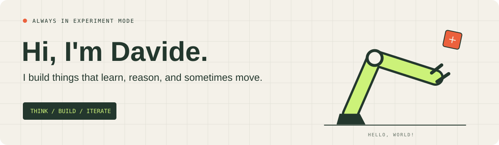

<a href="https://davidechen135.github.io/"></a>

<p align="center">
  <a href="https://davidechen135.github.io/"><strong>✳ Explore my interactive homepage ↗</strong></a>
  &nbsp; · &nbsp;
  <a href="#selected-projects">Browse the projects ↓</a>
</p>

### A little theory. A lot of tinkering.

I'm **ChenDavide**. I build and explore learning systems that connect observations to useful decisions — from robot actions and generated worlds to recommendations, bidding, and causal effects.

My interests span **embodied intelligence**, **world models**, **recommendation systems**, and **decision science**. I like turning a question into an implementation, then asking what the evaluation actually tells us.

```text
observe → model → decide → build → evaluate → repeat
```

### Selected projects

#### 🟠 Recommendation & decision science

| Project | Focus | Toolbox |
| :--- | :--- | :--- |
| **[Recommendation Pipeline](https://github.com/davidechen135/recsys-two-tower-mmoe)** | Dual-encoder retrieval followed by multi-task click and conversion ranking. | Two-Tower · FAISS · MMoE · DIN |
| **[Bidding & Budget Pacing](https://github.com/davidechen135/ads-bidding-lp-dual-bandit)** | Constrained bidding, online budget allocation, and contextual exploration. | LP Dual · LinUCB · RTB |
| **[Uplift & Experimentation](https://github.com/davidechen135/uplift-causal-ab-cuped)** | Incremental treatment effects, experiment diagnostics, and variance reduction. | S/T/X-Learners · CUPED · A/B Testing |

#### 🟢 Robotics, world models & physical structure

| Project | The question behind the code |
| :--- | :--- |
| **[RynnWorld-Action](https://github.com/davidechen135/RynnWorld-Action)** | How can native robot trajectories condition generated video? |
| **[Async-LiftControl](https://github.com/davidechen135/Async-LiftControl)** | How can model inference and robot execution operate asynchronously? |
| **[Isaac ARXlift2](https://github.com/davidechen135/isaac-arxlift2)** | How can simulation, data replay, and inference fit together? |
| **[PI-TimesNet](https://github.com/davidechen135/PITimesnet)** | How can physical structure inform temporal modeling? |

### Step into the lab

A filterable project collection, a few experiments, and an interactive robot arm. Move the target. See what happens.

**[Visit chendavide's playground →](https://davidechen135.github.io/)**

---

<sub>Good questions. Working code. &nbsp; ✳ &nbsp; Methodology, setup, and evaluation details are documented in the linked repositories.</sub>
